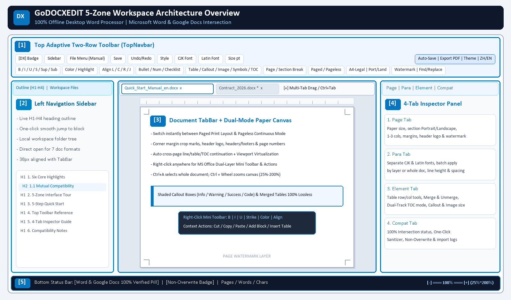
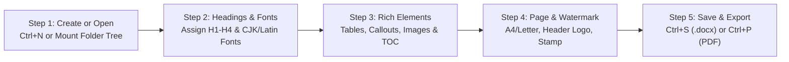

# GoDOCXEDIT Quick Start & Feature Manual (English Edition)

**Complete First-Time User Guide — 100% Offline Single-Executable Word Processor Built on the Strict Intersection of Microsoft Word and Google Docs**

> [!TIP]
> **Language-Synced Live Manual Inside the App**: GoDOCXEDIT remembers your preferred UI language on startup (detecting your OS language on first launch) and opens the matching `.docx` manual automatically. Clicking the top-right language toggle (**`EN / 中`**) **swaps the open manual tab in place between English and Traditional Chinese while keeping your current chapter position** (and background Auto-Save skips built-in manuals so casual testing never overwrites the master file). For the Traditional Chinese manual, see [Quick_Start_Manual_zh-TW.md](./Quick_Start_Manual_zh-TW.md).

---

## Table of Contents

1. [Why Choose GoDOCXEDIT? Six Signature Selling Points](#1-why-choose-godocxedit-six-signature-selling-points)
2. [Five-Minute Workspace Tour (With 300 DPI Annotated Diagram)](#2-five-minute-workspace-tour-with-300-dpi-annotated-diagram)
3. [Three-Minute, Five-Step Quick Start Walkthrough](#3-three-minute-five-step-quick-start-walkthrough)
4. [Complete Top Two-Row Toolbar Button Reference](#4-complete-top-two-row-toolbar-button-reference)
5. [Right Four-Tab Inspector Panel: Field-by-Field Reference](#5-right-four-tab-inspector-panel-field-by-field-reference)
6. [Signature Workflows & Compatibility Boundaries](#6-signature-workflows--compatibility-boundaries)
7. [Dual-Layer Context Menu, Multi-Tab Tips & Keyboard Shortcuts](#7-dual-layer-context-menu-multi-tab-tips--keyboard-shortcuts)
8. [Frequently Asked Questions (FAQ)](#8-frequently-asked-questions-faq)

---

## 1. Why Choose GoDOCXEDIT? Six Signature Selling Points

In modern business collaboration, legal contract reviews, executive proposals, and technical documentation, a single `.docx` file routinely moves back and forth between desktop **Microsoft Word** and cloud-based **Google Docs**. Traditional word processors often mix single-vendor local fonts, leave East Asian and Western font slots mismatched, or rely on proprietary floating effects—causing unexpected font substitution, broken table alignments, and shifted page counts the moment a recipient opens the file on the other platform.

As part of the **GoEdit** offline desktop productivity family (alongside `GoMDEDIT` for Markdown and `GoSLIDEEDIT` for presentations), **GoDOCXEDIT** is engineered strictly around the **100% Intersection** of Microsoft Word and Google Docs:

| Signature Selling Point | Business Pain Point Solved | Practical Value Delivered |
| :--- | :--- | :--- |
| **1. 100% Word & Google Docs Intersection Compatibility** | Cross-platform sharing triggers font fallback, altered line wraps, and broken pagination. | Curates **15 cross-platform Safe Fonts** with separate **Chinese (CJK)** and **English (ASCII)** selectors that automatically split and bind mixed-script runs for zero layout drift. |
| **2. 100% Offline Single Executable (`.exe`) & Zero Cloud Exposure** | Confidential contracts, financial statements, and internal memos cannot be uploaded to cloud apps or installed on locked-down workstations. | Portable `GoDOCXEDIT.exe` launches instantly without installation or internet access, powered by **Viewport Page Virtualization** for smooth scrolling on multi-thousand-paragraph documents. |
| **3. Smart Font Normalization + Non-Overwrite Protection** | Opening an external file with custom fonts risks overwriting a client's original file via background auto-save. | Unsupported fonts map cleanly to safe equivalents with full diagnostics in the **Compat** tab, while **background Auto-Save automatically pauses** until you explicitly press `Ctrl+S`. |
| **4. Complete Executive & Business Layout Suite** | Lightweight editors cannot handle mixed Portrait/Landscape sections, merged cells, watermarks, or batch spacing. | Supports **per-section Portrait/Landscape breaks**, **Dual-Track Table of Contents**, **horizontal/vertical cell merging & nested sub-tables**, **header logos**, **text/image watermarks**, and **batch font/spacing updates by layer**. |
| **5. 7-Format Bidirectional I/O + 1:1 Zero-Drift PDF** | Different clients, portals, and archives demand `.odt`, `.rtf`, `.html`, `.md`, `.txt`, or print-exact `.pdf`. | Saves standard `.docx` by default while importing/exporting `.docx`, `.odt`, `.rtf`, `.html`, `.md`, and `.txt`, plus zero-drift 1:1 Print / PDF export (`Ctrl+P`). |
| **6. High-Efficiency GoEdit Family Workspace** | Juggling multiple open documents and repeatedly reaching up to top menus slows down writing. | Combines a local workspace folder tree, draggable multi-file tabs, MS Office-style dual-layer right-click mini toolbar, Light/Dark themes, and instant EN/ZH UI switching. |

### The 15 Cross-Platform Safe Fonts Whitelist

| Font Category | Verified Safe Fonts (Word & Google Docs Intersection) | Recommended Business Scenarios |
| :--- | :--- | :--- |
| **Western Sans-Serif (7)** | `Calibri`, `Arial`, `Arial Black`, `Verdana`, `Tahoma`, `Trebuchet MS`, `Impact` | Executive reports, corporate proposals, modern memos, bold callout headers |
| **Western Serif (4)** | `Times New Roman`, `Georgia`, `Cambria`, `Garamond` | Legal contracts, formal correspondence, academic & policy papers |
| **Western Monospace (1)** | `Courier New` | Technical specifications, code snippets, fixed-width data references |
| **Traditional Chinese / CJK (3)** | `Microsoft JhengHei`, `PMingLiU`, `DFKai-SB` | Bilingual proposals, official government/legal documents, CJK business reports |

---

## 2. Five-Minute Workspace Tour (With 300 DPI Annotated Diagram)

GoDOCXEDIT organizes every capability into five clean workspace zones. Both side panels can be collapsed at any time for distraction-free writing:

| Zone & Name | Screen Position | Primary Responsibilities |
| :--- | :--- | :--- |
| **`[1]` Top Adaptive Two-Row Toolbar** | Full width at the top | Houses the `[DX]` brand badge, sidebar toggle, `File` menu, Quick Save, Undo/Redo, paragraph style selector, **independent CJK & English font menus**, inline formatting, lists, Table/Callout/Image/Symbols/TOC/Section insertion, Paged/Pageless toggle, paper size & orientation, watermark menu, Auto-Save, Export PDF, Theme, and language switch. |
| **`[2]` Left Navigation Sidebar** | Left side (collapsible) | Strictly aligned at `38px` header height with the document TabBar. Provides **`Outline`** (live `H1–H4` heading tree with one-click jump) and **`Files`** (local folder tree supporting direct open for all 7 document formats). |
| **`[3]` Multi-Tab Bar & Central Paper Canvas** | Center main stage | Top `38px` TabBar supports multiple open tabs, mouse-wheel horizontal scrolling, and drag-and-drop reordering; below sits the **Paged Print Layout** (with ruler & corner crop marks) or **Pageless Continuous** canvas. |
| **`[4]` Right Four-Tab Inspector Panel** | Right side (collapsible) | Organized into **`Page`**, **`Para`**, **`Element`**, and **`Compat`** tabs for margins, full watermark styling, batch font/line-spacing controls, cell merge/unmerge actions, and normalization diagnostics. |
| **`[5]` Bottom Status & Zoom Bar** | Full width at the bottom | Displays the `Word ∩ Google Docs 100% Verified` pill, active Non-Overwrite Protection badge, estimated pages/words/characters, and the `25% ~ 200%` canvas zoom slider. |

---

## 3. Three-Minute, Five-Step Quick Start Walkthrough

Follow this five-step workflow to produce your first cross-platform business document:

1. **Step 1 | Create a New Document or Open a Workspace Folder**
   - Click **`File -> New Document (.docx)`** (`Ctrl+N`), or choose **`File -> Open Workspace Folder...`** to mount an entire project directory in the left `Files` tree for single-click file switching.
2. **Step 2 | Structure Headings & Choose Separate CJK / English Fonts**
   - Format chapter titles as `Heading 1` through `Heading 4` so the left `Outline` panel builds an interactive navigation tree automatically.
   - Select your preferred **English Font** (e.g., `EN: Calibri` or `EN: Georgia`) and **CJK Font** independently on the top toolbar—mixed-language typing splits and binds fonts automatically as you type.
3. **Step 3 | Insert Tables, Callout Boxes, 300 DPI Images & TOC**
   - Use the top toolbar to insert grid **Tables**, **Shaded Callout / Code Boxes** (`Business Info`, `Warning`, `Success`, `Code Block`), **Images** (automatically normalized to crisp 300 DPI `.png` via file picker, drag-and-drop, or paste), and a clickable **Table of Contents**.
4. **Step 4 | Configure Page Geometry, Headers/Footers & Watermarks**
   - Open the right **`Page`** tab to adjust paper size (`A4`, `Letter`, `Legal`, etc.), margins, `Different First Page`, and footer page numbers. Click the **Stamp** icon on the toolbar to apply a `CONFIDENTIAL` diagonal watermark or company logo watermark.
5. **Step 5 | Atomic Save & 1:1 Zero-Drift PDF Export**
   - Press `Ctrl+S` for atomic `.docx` saving, or click **`Export PDF`** (`Ctrl+P`) on the top-right to generate a print-exact PDF matching your portrait and landscape sections.

---

## 4. Complete Top Two-Row Toolbar Button Reference

### 4.1 Group 1: Brand Badge, File Menu, History & Dual-Script Typography

| Control / Dropdown | Shortcut | Function & Practical Usage |
| :--- | :--- | :--- |
| **`[DX] GoDOCXEDIT` Badge** | — | GoEdit family dual-compartment brand emblem in Antigravity Highlight Blue. |
| **Toggle Left Sidebar** | — | Expands or collapses the left `Outline \| Files` navigation panel. |
| **`File` Dropdown Menu** | — | Access New Document, Open File, Open Workspace Folder, **Open Quick Start Manual (.docx)**, Save, Save As, and Export to `.pdf`, `.odt`, `.rtf`, `.html`, `.md`, or `.txt`. |
| **Quick Save** | `Ctrl+S` | Atomically saves the active tab via `.tmp` replacement to prevent file corruption. |
| **Undo / Redo** | `Ctrl+Z` / `Ctrl+Y` | Multi-step undo/redo history covering inline edits, batch style changes, and Replace All. |
| **Paragraph Style Selector** | — | Assign `Normal Text`, `Document Title`, `Subtitle`, or `Heading 1` – `Heading 4`. |
| **Chinese / CJK Font Selector** | — | Sets the font exclusively for CJK characters and full-width punctuation without affecting English runs. |
| **English / ASCII Font Selector** | — | Sets the font exclusively for English letters, digits, and ASCII punctuation across 12 Western Safe Fonts. |
| **Font Size Selector (`pt`)** | — | Standard point sizes from `8 pt` to `72 pt`. |

### 4.2 Group 2: Inline Formatting, Color Swatches, Alignment & Lists

| Control / Dropdown | Shortcut | Function & Practical Usage |
| :--- | :--- | :--- |
| **Bold / Italic / Underline / Strikethrough** | `Ctrl+B` / `I` / `U` | Character-level formatting on any selected text range, preserving multi-run styling within paragraphs. |
| **Superscript (`X²`) / Subscript (`X₂`)** | — | Ideal for exponents, footnote indices, trademarks, and chemical formulas (`H₂O`). |
| **Text Color (`A`) / Highlight (`H`)** | — | Cross-platform high-contrast text colors and background shading highlights (with one-click clear). |
| **Clear Formatting (Eraser)** | — | Removes inline character overrides on the selected range or paragraph. |
| **Align Left / Center / Right / Justify** | — | Standard paragraph alignments; `Justify` creates clean left and right margins for contracts and reports. |
| **Bullet / Ordered / Checklist** | — | Bulleted lists, numbered lists, and interactive clickable Checklists. |
| **Blockquote** | — | Applies an accented left border and indentation for highlighted quotations. |

### 4.3 Group 3 & Right Global Controls: Insertions, Layout, Watermarks & System Toggles

| Control / Dropdown | Shortcut | Function & Practical Usage |
| :--- | :--- | :--- |
| **Insert Table (8x8 Grid Picker)** | — | Drag-hover up to `8 × 8` cells to insert a table; add/delete rows or merge cells later in the `Element` tab. |
| **Insert Callout / Code Box** | — | Choose **Business Info**, **Warning**, **Success**, or **Code Block** (rendered as 100% compatible shaded boxes). |
| **Insert Image** | — | Supports `.png`, `.jpg`, `.jpeg`, `.webp`, `.svg`, `.bmp`, and `.gif`, automatically normalized to **300 DPI `.png`**. |
| **Symbols & Formulas (`Ω`)** | — | Organized palette of Currency, Legal (`© ® ™ §`), Math operators, Greek letters, and scientific formulas. |
| **Insert TOC / Horizontal Rule** | — | Inserts a clickable Table of Contents block or horizontal section divider. |
| **Insert Page Break / Section Break** | — | **Page Break** starts a new page; **Section Break (Scissors icon)** starts an independent section so the next page can switch between Portrait and Landscape. |
| **View Mode (`Pages` / `Pageless`)** | — | Switches instantly between fixed-sheet Paged Print Layout and wide Pageless Continuous drafting mode. |
| **Paper Size / Section Orient** | — | Select `A3`, `B4`, `A4`, `B5`, `A5`, `Letter`, or `Legal`, and toggle the active section between `Port` and `Land`. |
| **Page Watermark Menu (Stamp)** | — | Apply quick text presets (`CONFIDENTIAL`, `DRAFT`, `INTERNAL`, `DO NOT COPY`, `SAMPLE`) or pick a logo image watermark. |
| **Find & Replace (Search Icon)** | `Ctrl+F` / `Ctrl+H` | Opens Find & Replace with literal regex escaping, match counter badge, next/previous navigation, and Replace All. |
| **Auto-Save / Export PDF / Theme / Lang / Inspector** | `Ctrl+P` | Right-anchored controls: Auto-Save toggle, Export PDF button, Light/Dark theme toggle, `EN / 中` UI language toggle, and Right Inspector drawer toggle. |

---

## 5. Right Four-Tab Inspector Panel: Field-by-Field Reference

### 5.1 `Page` Tab
- **View Mode & Paper Size**: Switch between Paged Print Layout and Pageless Continuous mode across 7 international paper sizes.
- **Section Orientation & Section Breaks**: Displays your active section index (e.g., `Sec 1/2 Orient`), toggles that specific section between Portrait and Landscape, inserts a Next-Page Section Break, or applies the current orientation to all sections at once.
- **Columns & Page Margins (mm)**: Choose `1`, `2`, or `3` columns; pick `Normal` (25.4mm), `Narrow` (12.7mm), or `Wide` (50.8mm) presets, or enter custom Top/Bottom/Left/Right margins (`5 ~ 75 mm`).
- **Header, Footer & Page Numbers**: Toggle `Different First Page` (for cover pages), show/hide automatic footer page numbers, and align page numbers Left, Center, or Right.
- **Page Watermark Configuration**:
  - **Text Watermark**: Quick business presets, custom watermark text, 15 Safe Fonts, `36 / 54 / 72 / 90 pt` sizes, Diagonal (`-45°`) or Horizontal (`0°`) angle, 6 color swatches, and `10% ~ 80%` washout opacity slider.
  - **Image Watermark**: Upload/replace watermark image (300 DPI PNG), select `50% ~ 200%` scale, and adjust washout opacity.

### 5.2 `Para` Tab
- **Single-Block Default vs. Layer & Whole-Document Batch Buttons**: Direct changes adjust only your selected block by default, paired with two time-saving batch buttons:
  - **`Apply Font & Size to All "[Layer]"`**: Updates every block of the active style (e.g., all `Heading 1` titles or all `Table Cells`) in one click without touching other styles.
  - **`Apply CJK & Latin Fonts to Entire Doc (Keep Sizes)`**: Unifies CJK and English fonts across the entire document while preserving every heading and body font size!
- **Line Height & Paragraph Spacing**: Quick chips (`1.0x`, `1.15x`, `1.25x`, `1.5x`, `1.75x`, `2.0x`), custom multiplier (`1.00 ~ 3.00`), and Before/After spacing (`0 ~ 72 pt`), plus batch buttons to apply spacing across the same category or the entire document.
- **Indentation**: Precision `Left Indent (pt)` and `First-Line Indent (pt)` inputs.

### 5.3 `Element` Tab
Context-aware controls appear automatically based on your canvas selection:
- **When a Table is selected**: Insert rows above/below, insert columns left/right, delete row/column, toggle Header Row emphasis, and customize border width/color. Clicking a cell unlocks **`Merge Right`**, **`Merge Down`**, **`Unmerge Selected Cell`**, Vertical Align (`Top` / `Middle` / `Bottom`), and 7 cell background shading swatches.
- **When a Table of Contents is selected**: Switch between **`Original Page TOC`** (preserving imported Word TOC entries and page numbers with click-to-jump) and **`Dynamic Heading Outline (H1–H4)`** (automatically synced from live document headings).
- **When a Callout Box is selected**: Switch seamlessly among `Business Info`, `Warning`, `Success`, and `Code Block`.
- **When an Image is selected**: Adjust display width (`80 ~ 720 px` with automatic aspect ratio lock) and Left/Center/Right alignment.

### 5.4 `Compat` Tab
- **Intersection Verification & One-Click Sanitizer**: Displays `Word ∩ Google Docs 100% Verified` status and provides the **`Run Full Compatibility Sanitizer`** button.
- **Non-Overwrite Banner & Normalization Diagnostics**: Lists clear explanations whenever an imported external file had unsupported fonts or single-vendor attributes normalized.

---

## 6. Signature Workflows & Compatibility Boundaries

### 6.1 Safe External File Workflow: Non-Overwrite Protection

Whenever you open an external `.docx` containing non-whitelisted fonts or single-platform effects:
1. **Automatic Safe Mapping**: Unsupported fonts are mapped in memory to the closest Safe Font so the document renders cleanly, and an unsaved asterisk (`*`) appears on the tab.
2. **Background Auto-Save Paused**: Even if `Auto-Save` is enabled on the toolbar, background overwriting is paused and **`Non-Overwrite Protected (Press Ctrl+S)`** appears on the status bar.
3. **Your Choice**: Close the tab or press `Ctrl+Shift+S` (`Save As`) to leave the original file untouched, or press `Ctrl+S` once to confirm and atomically write the normalized cross-platform file.

### 6.2 Mixing Portrait & Landscape Pages in One Document

1. Place your cursor in the last paragraph before the wide table page.
2. Click the **Scissors icon (`Insert Section Break: Next Page`)** on the top toolbar.
3. Click inside the newly created page and click the **`Port / Land`** button on the toolbar to switch that section to **`Landscape`**.
4. To return to Portrait on subsequent pages, insert another Section Break after the table and toggle the new section back to `Portrait`.

### 6.3 Important Compatibility Boundary: Complex Custom MS-Word Tables (e.g., Traditional Chinese Resumes)

GoDOCXEDIT strictly enforces the **Microsoft Word and Google Docs mutual intersection** so every saved table renders reliably across both platforms.

> [!WARNING]
> **Compatibility Notice Regarding Proprietary MS-Word Custom Tables (Such as Traditional Chinese Resume Formats)**
> Because Microsoft Word supports extensive single-vendor custom formatting outside the Word & Google Docs intersection, intricate custom MS-Word tables — **such as traditional Chinese resume formats (中文履歷表) constructed with staggered hand-drawn gridlines, misaligned split cells across rows, distributed-justify cell alignment, diagonal cell borders, or nested floating text boxes** — **may not open with identical layout fidelity or may display simplified gridlines in GoDOCXEDIT**.
>
> **Recommended Practice**:
> 1. If you open such a complex resume file and observe table differences, rest assured that **Non-Overwrite Protection pauses Auto-Save automatically**—closing the tab leaves your original file completely unmodified.
> 2. Keep legacy documents that depend heavily on MS-Word-only custom grid tricks in native Microsoft Word; when creating modern resumes, application forms, or business tables meant to travel cleanly between Microsoft Word and Google Docs without layout breakage, build them directly with GoDOCXEDIT's standard merged tables.

---

## 7. Dual-Layer Context Menu, Multi-Tab Tips & Keyboard Shortcuts

### Three Built-In Productivity Accelerators
- **MS Office-Style Dual-Layer Right-Click Menu**: Right-click anywhere on the canvas to display both the floating **Mini Formatting Toolbar** (Bold, Italic, Underline, Strike, Color, Highlight, Align) and the **Action Menu** (Cut, Copy, Paste, Insert Paragraph Above/Below, Insert Table, Delete Block) right at your cursor.
- **Smooth Multi-Tab Management**: Scroll your mouse wheel horizontally over the TabBar when many documents are open, or drag tabs left/right to reorder them.
- **Single-Press `Ctrl+A` Whole-Document Selection**: Press `Ctrl+A` once inside the canvas to select all blocks across the entire document—change fonts, point sizes, colors, or copy the entire text in a single step.

### Keyboard Shortcuts Reference

| Category | Shortcut | Action |
| :--- | :--- | :--- |
| **File & Export** | `Ctrl + N` | Create a new `.docx` document |
| **File & Export** | `Ctrl + O` | Open file dialog (`.docx`, `.odt`, `.rtf`, `.html`, `.htm`, `.txt`, `.md`) |
| **File & Export** | `Ctrl + S` | Quick atomic save (clears Non-Overwrite lock on normalized imports) |
| **File & Export** | `Ctrl + Shift + S` | Save As dialog |
| **File & Export** | `Ctrl + P` | 1:1 Print / Export PDF (honoring per-section Portrait & Landscape pages) |
| **Tab Navigation** | `Ctrl + W` | Close active document tab |
| **Tab Navigation** | `Ctrl + Tab` | Switch to next document tab |
| **Tab Navigation** | `Ctrl + Shift + Tab` | Switch to previous document tab |
| **Editing & Search** | `Ctrl + A` | Select entire document (batch format, copy, or clear with Undo support) |
| **Editing & Search** | `Ctrl + Z` / `Ctrl + Y` | Undo / Redo |
| **Editing & Search** | `Ctrl + F` / `Ctrl + H` | Find / Find & Replace bar |
| **Inline Formatting** | `Ctrl + B` / `I` / `U` | Toggle Bold / Italic / Underline on selected text |
| **Canvas Zoom** | `Ctrl + Mouse Wheel` | Zoom paper canvas (`25% ~ 200%`) without distorting UI toolbars |

---

## 8. Frequently Asked Questions (FAQ)

### Q1: Why does the font menu list 15 specific fonts instead of every font installed on my computer?
**Answer**: Limiting typography to the **15 verified Safe Fonts** is what guarantees **100% zero-drift compatibility between Microsoft Word and Google Docs**. Local custom fonts trigger silent font substitution and shifted page breaks as soon as a file is opened on another PC or in Google Docs.

### Q2: Why are Chinese (CJK) and English (ASCII) fonts split into two separate dropdowns?
**Answer**: In bilingual business documents, authors frequently pair a clean CJK font (such as `Microsoft JhengHei`) with a classic Western font (such as `Calibri`, `Georgia`, or `Times New Roman`). Separate selectors let GoDOCXEDIT automatically detect and bind each script as you type—no manual word-by-word font switching required.

### Q3: Why does the status bar say `Non-Overwrite Protected` even when `Auto-Save` is checked?
**Answer**: Whenever an opened external file required font or attribute normalization on import, GoDOCXEDIT pauses background Auto-Save so simply inspecting a file never overwrites the original on disk. Press `Ctrl+S` once whenever you intentionally want to save changes.

### Q4: Why do certain complex MS-Word resume templates (like traditional Chinese resume grids) look different when opened?
**Answer**: MS-Word permits proprietary custom table structures (staggered split cells, hand-drawn misaligned borders, diagonal cell headers, floating text boxes) that are not supported across the Word & Google Docs intersection. Keep Word-proprietary resume layouts in MS-Word, or build cross-platform tables directly in GoDOCXEDIT.

### Q5: Does GoDOCXEDIT require an internet connection or upload any document content to the cloud?
**Answer**: **Never**. `GoDOCXEDIT.exe` runs 100% offline on your local machine with zero network requests and zero cloud uploads—making it ideal for confidential legal contracts, financial reports, and air-gapped enterprise environments.
