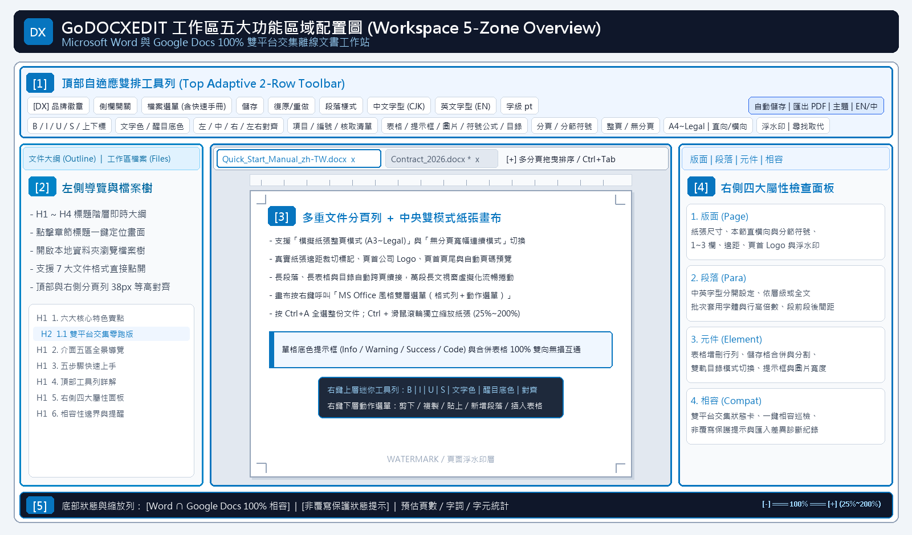
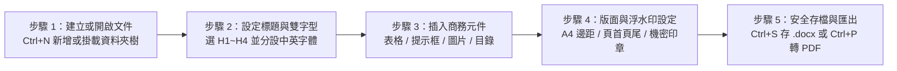

# GoDOCXEDIT 快速入門與特色實戰手冊（正體中文詳盡版）

**專為初次使用者打造的全景操作指南 — 100% 離線單一執行檔、Microsoft Word 與 Google Docs 雙平台交集零跑版文書工作站**

> [!TIP]
> **隨語系自動連動、隨開即用的互動式活體手冊**：當您啟動 `GoDOCXEDIT.exe` 時，畫面會依您上次使用的語系（首次啟動依系統語系判斷）預設載入對應版本的教學手冊；在閱讀教學手冊時點擊視窗右上角 **`EN`** 按鈕切換語系，教學分頁會**自動原地切換為英文版並對齊目前閱讀章節**（隨手試玩塗改亦不會在背景覆寫原版手冊）。英文版獨立文件請參閱 [Quick_Start_Manual_en.md](./Quick_Start_Manual_en.md)。

---

## 目錄（Table of Contents）

1. [為什麼選擇 GoDOCXEDIT？六大核心特色賣點](#1-為什麼選擇-godocxedit六大核心特色賣點)
2. [五分鐘認識工作區五大區域（含 300 DPI 標註配置圖）](#2-五分鐘認識工作區五大區域含-300-dpi-標註配置圖)
3. [三分鐘五步驟快速上手實戰](#3-三分鐘五步驟快速上手實戰)
4. [頂部雙排工具列完整按鈕詳解](#4-頂部雙排工具列完整按鈕詳解)
5. [右側四大屬性檢查面板（Inspector）逐欄詳解](#5-右側四大屬性檢查面板inspector逐欄詳解)
6. [獨家進階流程與「雙平台交集相容性邊界提醒」](#6-獨家進階流程與雙平台交集相容性邊界提醒)
7. [雙層右鍵選單、多分頁管理與全套快捷鍵速查表](#7-雙層右鍵選單多分頁管理與全套快捷鍵速查表)
8. [新手常見問答（FAQ）](#8-新手常見問答faq)

---

## 1. 為什麼選擇 GoDOCXEDIT？六大核心特色賣點

在日常商務協作、法務合約審閱、專案提案與研究報告編寫中，同一份 `.docx` 文件經常在桌面版 **Microsoft Word** 與雲端 **Google Docs** 之間來回傳遞。傳統文書軟體一旦混用了單一平台專屬字型、未同步綁定中西文字體屬性，或使用了單一廠商獨有的浮動排版特效，對方打開時便容易出現字型跳成新細明體、行距走位、表格破版或頁數改變。

**GoDOCXEDIT** 隸屬於 GoEdit 離線桌面生產力家族（與 Markdown 雙向編輯器 `GoMDEDIT`、簡報編輯器 `GoSLIDEEDIT` 同系），從底層設計即嚴格鎖定兩大平台的 **100% 雙平台交集**，為您帶來六大核心價值：

| 核心特色賣點 | 解決的商務痛點 | 實際帶來的效益 |
| :--- | :--- | :--- |
| **1. Word 與 Google Docs 100% 雙平台交集零跑版** | 跨平台傳檔常發生中英文字體跳號、段落斷行改變與版面走位。 | 嚴選 **15 款雙平台交集安全字型**，提供獨立「中文字型」與「英文字型」選單，輸入中英混排內容時自動切分並同步綁定字體設定，雙向開啟 100% 一致。 |
| **2. 100% 離線單一執行檔（`.exe`）免安裝高隱私** | 機密合約、財報與內部公文不便上傳雲端，或公司電腦受權限管制無法安裝龐大套件。 | 單一 `GoDOCXEDIT.exe` 免安裝雙擊即用、完全不連網、零雲端上傳風險；同時內建視窗頁面虛擬化引擎，處理上百頁、上萬段長文依然流暢不卡頓。 |
| **3. 外部舊檔智慧正規化 ＋「非覆寫安全保護」** | 開啟客戶或同事傳來的舊檔時，擔心背景自動存檔不慎改寫破壞原檔。 | 外部檔案若含非安全字型，匯入時自動映射為安全字型並記錄於「相容」面板，同時**自動暫停自動存檔**，在您親自按下 `Ctrl+S` 前絕不覆蓋原檔。 |
| **4. 高階商務長文與複雜表單排版一次到位** | 一般輕量文書工具不支援直橫頁混排、自動目錄、合併儲存格或浮水印。 | 原生支援**同檔多節獨立直向／橫向混排**、**雙軌目錄**（保留原頁碼跳轉／動態大綱同步）、**跨欄跨列合併與巢狀表格**、**頁首公司 Logo**、**文字／圖片浮水印**及**依層級批次套用字體與行距**。 |
| **5. 七大主流格式雙向互通 ＋ 1:1 零誤差 PDF** | 不同客戶、政府機關或知識庫系統要求 `.odt`、`.rtf`、`.md`、`.html` 或列印級 `.pdf`。 | 預設儲存標準 `.docx`，支援開啟與匯出 `.docx`、`.odt`、`.rtf`、`.html`、`.md`、`.txt`，並支援 `Ctrl+P` 依各節直橫向 1:1 零誤差列印與匯出 PDF。 |
| **6. GoEdit 家族直覺高效率工作區體驗** | 比對多份文件時視窗切換混亂，頻繁移動滑鼠往返頂部工具列耗時費力。 | 整合本地工作區資料夾樹、多分頁拖曳排序、MS Office 風格雙層右鍵浮動工具列、深色／淺色護眼主題與「中／EN」介面一鍵切換。 |

### 15 款雙平台交集安全字型白名單一覽

| 字型分類 | 內建雙平台交集安全字型 | 推薦商務應用場景 |
| :--- | :--- | :--- |
| **繁體中文字型（3 款）** | `Microsoft JhengHei`（微軟正黑體）、`PMingLiU`（新細明體）、`DFKai-SB`（標楷體） | 現代企業企劃書、正式合約條款、政府與學術公文 |
| **西文無襯線字型（7 款）** | `Calibri`、`Arial`、`Arial Black`、`Verdana`、`Tahoma`、`Trebuchet MS`、`Impact` | 跨國商務報告、現代科技提案、醒目數據標題 |
| **西文襯線字型（4 款）** | `Times New Roman`、`Georgia`、`Cambria`、`Garamond` | 英文法務合約、正式信函、研究論文與白皮書 |
| **西文等寬字型（1 款）** | `Courier New` | 技術規格書、程式碼區塊、編號與對齊數據表 |

---

## 2. 五分鐘認識工作區五大區域（含 300 DPI 標註配置圖）

啟動 GoDOCXEDIT 後，工作區由五個職責分明的區域構成。左右兩側面板皆可隨時收合，讓中央紙張畫布獲得最大視野：

| 區域標號與名稱 | 畫面位置 | 核心功能說明 |
| :--- | :--- | :--- |
| **`[1]` 頂部自適應雙排工具列** | 視窗最上方全寬 | 整合品牌徽章、側欄收合鈕、「檔案」選單、儲存、復原重做、段落層級、**中／英雙字型獨立選單**、行內樣式、清單、插入表格／提示框／圖片／符號公式／目錄／分節符號、檢視模式、紙張直橫向、浮水印、自動儲存、匯出 PDF、主題與語言切換。 |
| **`[2]` 左側大綱與檔案導覽欄** | 視窗左側（可收合） | 頂部切換列與右側文件分頁列嚴格保持 `38px` 水平等高對齊。內含 **「文件大綱 (Outline)」**（自動擷取 `H1 ~ H4` 標題點擊跳轉）與 **「工作區檔案 (Files)」**（掛載本地資料夾直接點開 7 大格式文件）。 |
| **`[3]` 多分頁列與中央紙張畫布** | 視窗中央主舞台 | 上方分頁列支援多文件同時開啟、滾輪橫向捲動與拖曳排序；下方畫布支援 **「模擬紙張整頁模式（含尺規與四角邊距裁切標記）」** 與 **「無分頁寬幅連續模式」** 一鍵切換。 |
| **`[4]` 右側四大屬性檢查面板** | 視窗右側（可收合） | 分為 **「版面」**、**「段落」**、**「元件」**、**「相容」** 四個分頁，提供紙張邊距、浮水印細節、依層級批次改字體與行距、儲存格合併分割及外部檔案正規化診斷。 |
| **`[5]` 底部統計與縮放狀態列** | 視窗最下方全寬 | 左側顯示「Word ∩ Google Docs 100% 相容」狀態膠囊、非覆寫保護提示、預估頁數／字詞／字元統計；右側提供 `25% ~ 200%` 畫布獨立縮放滑桿與百分比快選。 |

---

## 3. 三分鐘五步驟快速上手實戰

第一次使用 GoDOCXEDIT 建立正式文件時，只需依序完成以下五個步驟：

1. **步驟 1｜建立空白文件或掛載專案資料夾**
   - 點擊左上角 **「檔案 -> 新增空白文件 (.docx)」**（`Ctrl+N`）開始撰寫；若手邊有多份參考資料，可點擊 **「檔案 -> 開啟工作區資料夾」**，左側「檔案」分頁便會列出資料夾內所有支援文件供一鍵點開。
2. **步驟 2｜建立章節標題大綱並設定中英雙字型**
   - 將章節標題設為 `標題 1 (Heading 1)` 至 `標題 4 (Heading 4)`，左側「文件大綱」會即時產生階層目錄。
   - 在頂部工具列分別挑選**中文字型**（例如「中：微軟正黑體」）與**英文字型**（例如「EN：Calibri」或「EN：Georgia」），之後打字時系統會自動依中英文字元切分套用，再也不必手動逐段框選英數改字體。
3. **步驟 3｜插入商務表格、單格提示框、圖片與自動目錄**
   - 點擊頂部工具列的**表格圖示**拖選列欄數建立表格；點擊**程式碼／提示框圖示**插入醒目的藍／橘／綠商務提示框或等寬程式碼區塊；點擊**圖片圖示**（或直接拖放圖片進畫布）自動轉為 300 DPI 高解析 `.png`；最後在文件開頭插入**自動目錄**。
4. **步驟 4｜調整版面規格、頁首頁尾與浮水印**
   - 在右側 **「版面」** 面板確認紙張大小（預設 `A4`）、邊距與頁尾自動頁碼；可直接在紙張上下緣點擊編輯頁首／頁尾文字或上傳公司 Logo。若屬內部機密文件，點擊頂部**印章圖示**即可一鍵套用「機密 CONFIDENTIAL」斜向浮水印。
5. **步驟 5｜原子安全存檔與 1:1 匯出 PDF**
   - 按下 `Ctrl+S` 以安全暫存替換機制儲存標準 `.docx`；需要正式對外發佈或列印時，點擊右上角藍色 **「匯出 PDF」** 按鈕（`Ctrl+P`），即可獲得與畫面紙張 1:1 零誤差的 PDF 文件。

---

## 4. 頂部雙排工具列完整按鈕詳解

頂部導航與工具列分為**三大功能群組**與**最右側固定控制區**，視窗寬度縮小時會自動整齊排列為兩行：

### 4.1 第一群組：品牌、檔案管理、復原重做與雙語字型

| 按鈕／選單名稱 | 快捷鍵 | 詳細功能與實務操作說明 |
| :--- | :--- | :--- |
| **`[DX] GoDOCXEDIT` 品牌徽章** | — | 家族品牌識別徽章（Antigravity 醒目藍配色）。 |
| **切換左側導覽欄** | — | 展開或收合左側「文件大綱 \| 工作區檔案」側邊欄。 |
| **「檔案 (File)」下拉選單** | — | 包含：新增空白文件、開啟檔案、開啟工作區資料夾、**開啟快速入門手冊 (.docx)**、儲存檔案、另存新檔，以及匯出為 `.pdf` / `.odt` / `.rtf` / `.html` / `.md` / `.txt`。 |
| **快速儲存** | `Ctrl+S` | 將目前分頁透過 `.tmp` 暫存檔原子替換機制安全寫入磁碟，防止斷電損毀檔案。 |
| **復原 / 重做** | `Ctrl+Z` / `Ctrl+Y` | 支援多步驟編輯歷史復原與重做（包含全選改字體、批次行距與全部取代）。 |
| **段落樣式選單** | — | 切換 `內文 (Normal)`、`文件主標題 (Title)`、`副標題 (Subtitle)` 與 `標題 1 ~ 標題 4`。 |
| **中文字型選單（`中：...`）** | — | 獨立指定中文字元與全形標點的字型（微軟正黑體、新細明體、標楷體），不影響英數字體。 |
| **英文字型選單（`EN：...`）** | — | 獨立指定英文字母、數字與半形符號的字型（12 款西文安全字型），不影響中文字體。 |
| **字級大小選單（`pt`）** | — | 快速設定 `8 pt` 至 `72 pt` 標準字級。 |

### 4.2 第二群組：行內格式、色彩調色盤、對齊與清單引言

| 按鈕／選單名稱 | 快捷鍵 | 詳細功能與實務操作說明 |
| :--- | :--- | :--- |
| **粗體 / 斜體 / 底線 / 刪除線** | `Ctrl+B` / `I` / `U` | 支援反白選取段落內任意局部字詞精準套用，同一段落可並存多種不同樣式。 |
| **上標 (`X²`) / 下標 (`X₂`)** | — | 適用於平方公尺（`m²`）、科學指數、化學分子式（`H₂O`）與合約條款註記。 |
| **文字色彩 (`A`) / 醒目提示底色 (`H`)** | — | 內建雙平台交集高對比文字色彩與螢光筆底色色票，並提供一鍵清除醒目底色。 |
| **清除格式（橡皮擦）** | — | 將選取文字或整段的所有行內裝飾與色彩還原為乾淨預設狀態。 |
| **靠左 / 置中 / 靠右 / 左右對齊** | — | 四種標準段落水平對齊；長篇報告與合約推薦使用「左右對齊」使版心兩側整齊。 |
| **項目清單 / 編號清單 / 核取清單** | — | 切換圓點清單、自動編號清單，或可在畫布直接點擊打勾的待辦核取清單（Checklist）。 |
| **縮排引言（引號圖示）** | — | 為重要引述段落加上左側醒目藍色飾條與縮排視覺效果。 |

### 4.3 第三群組與右側控制區：插入元件、檢視紙張、浮水印與全域設定

| 按鈕／選單名稱 | 快捷鍵 | 詳細功能與實務操作說明 |
| :--- | :--- | :--- |
| **插入表格（網格選擇器）** | — | 滑鼠移過直覺點選最高 `8 × 8` 表格，建立後可於右側「元件」面板繼續擴充或合併儲存格。 |
| **插入單格底色區塊（Callout）** | — | 提供 **商務資訊（藍）**、**注意事項（橘）**、**核准通過（綠）**、**程式碼區塊（灰底等寬）** 四種醒目方塊。 |
| **插入圖片** | — | 支援 `.png`、`.jpg`、`.jpeg`、`.webp`、`.svg`、`.bmp`、`.gif`，自動正規化為 **300 DPI 標準 `.png`**。 |
| **商務符號與科學公式（`Ω`）** | — | 分類整理貨幣、法務智財（`© ® ™ §`）、數學運算、希臘字母與常用物理／統計公式，點擊即插入游標處。 |
| **插入自動目錄 / 水平分隔線** | — | 插入可點擊跳轉章節的目錄區塊，或插入段落水平分隔線。 |
| **插入分頁符號 / 插入分節符號** | — | **分頁符號**直接換至下一頁；**分節符號（剪刀圖示）**可開啟新的一節，讓下一頁獨立設定為橫向或直向。 |
| **檢視模式（`整頁` / `無分頁`）** | — | 在「模擬紙張整頁模式（預設）」與「無分頁寬幅連續模式（適合寬螢幕長文草擬）」間一鍵切換。 |
| **紙張尺寸 / 本節直橫向按鈕** | — | 整頁模式下快速切換 `A3`、`B4`、`A4`、`B5`、`A5`、`Letter`、`Legal` 七種紙張，以及切換目前所在節的 `直向 / 橫向`。 |
| **頁面浮水印選單（印章圖示）** | — | 一鍵套用「機密」、「草稿」、「內部文件」、「嚴禁複製」、「樣本」文字浮水印，或選取公司 Logo 圖片浮水印。 |
| **尋找與取代（放大鏡圖示）** | `Ctrl+F` / `Ctrl+H` | 開啟搜尋與取代工具列，支援跨段落與表格統計命中數、上下筆跳轉、單筆取代與全部取代。 |
| **自動儲存 / 匯出 PDF / 主題 / 語言 / 右側欄** | `Ctrl+P` | 右側固定控制區：勾選背景自動儲存、一鍵匯出 1:1 PDF、切換深淺色主題、切換 `EN / 中` 介面語言、展開或收合右側屬性面板。 |

---

## 5. 右側四大屬性檢查面板（Inspector）逐欄詳解

右側檢查面板將進階排版細項有條理地收斂為四個專屬分頁：

### 5.1 「版面 (Page)」分頁
- **檢視模式與紙張規格**：切換整頁／無分頁模式，選擇 7 種國際標準紙張尺寸。
- **本節方向與分節管理**：顯示目前游標位於第幾節（如 `第 1/2 節`），可單獨切換該節為直向或橫向、插入「分節符號：下一頁」，或將目前方向一次套用至整份文件所有節。
- **多欄排版**：切換單欄、雙欄或三欄版面配置。
- **紙張邊距設定（mm）**：提供「標準（25.4mm）」、「窄（12.7mm）」、「寬（50.8mm）」三組預設膠囊，以及上下左右獨立數值欄位（`5 ~ 75 mm`）。
- **頁首、頁尾與頁碼控制**：支援勾選「首頁不同（封面頁隱藏一般內頁頁首頁尾）」、「於頁尾顯示自動頁碼」與頁碼靠左／置中／靠右對齊。
- **頁面浮水印完整設定**：
  - **文字浮水印**：內建 5 組商務快選詞、自訂文字輸入框、15 款安全字型選擇、`36 / 54 / 72 / 90 pt` 四段尺寸、斜向（`-45°`）與水平（`0°`）排列、6 款色票及 `10% ~ 80%` 不透明度滑桿。
  - **圖片浮水印**：選擇或更換圖片（自動轉 300 DPI PNG）、調整 `50% ~ 200%` 縮放比例與刷淡不透明度。

### 5.2 「段落 (Para)」分頁
- **預設單一區塊微調 vs 批次套用**：直接調整時僅影響目前選取的單一區塊；透過下方批次按鈕則可瞬間統一整份文件：
  - **「套用字體與字級至所有同層級區塊」**：例如一鍵將全文件所有 `Heading 1` 統一改為「微軟正黑體 ＋ Arial 16pt」，完全不影響內文或其他標題。
  - **「套用中英文字型至全文件所有文字（保留各層級字級）」**：一鍵將整份文件的中文與英文字體全部換新，同時完整保留主標題、各階標題與內文原本的字級大小比例！
- **文字行高與段落間距**：內建 `1.0x`、`1.15x`、`1.25x`、`1.5x`、`1.75x`、`2.0x` 快選膠囊，支援 `1.00 ~ 3.00` 自訂行高倍數、`0 ~ 72 pt` 段前／段後間距，並同樣提供依層級（含表格儲存格、提示框）或全文件批次套用按鈕。
- **段落縮排**：精確調整左縮排（`pt`）與首行縮排（`pt`，例如中文正式報告常見的段首縮排）。

### 5.3 「元件 (Element)」分頁
點選畫布上的特定商務元件時，面板會自動呈現對應工具：
- **點選「表格」時**：可於上方／下方插入列、左側／右側插入欄、刪除目前列／欄、開關首列標題底色、調整框線粗細與色彩；點選任一儲存格後，可使用 **「向右合併」**、**「向下合併」**、**「取消合併儲存格（還原分割）」**、儲存格垂直對齊（靠上／垂直置中／靠下）及 7 款儲存格底色。
- **點選「目錄」時**：支援**雙軌目錄模式切換**——可在「保留原始頁碼目錄（匯入外部 Word 目錄時保留原始頁碼並支援點擊跳轉）」與「動態同步標題大綱（自動掃描文件內 `H1 ~ H4` 標題即時產生）」之間自由切換。
- **點選「單格底色區塊」時**：可隨時在商務資訊、注意事項、核准通過、程式碼區塊四種樣式間切換。
- **點選「圖片」時**：可輸入精確顯示寬度（`80 ~ 720 px`，自動維持長寬比例）並設定靠左、置中或靠右對齊。

### 5.4 「相容 (Compat)」分頁
- **雙平台相容狀態卡與一鍵巡檢**：確認文件符合 `Word ∩ Google Docs` 100% 雙向相容規範，並提供「執行全文件相容性巡檢與一鍵正規化」按鈕。
- **非覆寫安全保護提示與診斷紀錄**：當開啟的外部檔案含有非白名單字型或單一平台專屬屬性時，此處會清楚列出每一筆自動轉換紀錄（可隨時清除提示紀錄）。

---

## 6. 獨家進階流程與「雙平台交集相容性邊界提醒」

### 6.1 外部舊檔「非覆寫安全保護」標準作業流程

當您開啟外部傳來的 `.docx` 檔案且系統偵測到非安全字型或跨平台差異時，GoDOCXEDIT 會自動啟動以下保護流程：

1. **記憶體內智慧映射**：將非白名單字型自動對應至視覺最相近的安全字型（如標宋或細明體對應至新細明體、黑體對應至微軟正黑體），確保畫面立即清晰可讀。
2. **暫停背景自動存檔**：分頁出現未儲存星號 `*`，且底部狀態列亮起 **「非覆寫保護中 (按 Ctrl+S 儲存)」** 提示，即使右上角勾選了「自動儲存」也不會自動覆寫原檔。
3. **安心選擇後續動作**：
   - 只想瀏覽或保留原始檔案：直接關閉分頁，或按 `Ctrl+Shift+S` 另存新檔，原檔 100% 毫髮無傷。
   - 確認升級為雙平台交集相容檔：手動按下一次 `Ctrl+S`，系統即以安全原子寫入保存並解除鎖定。

### 6.2 同份文件「直向報告穿插橫向大報表」實戰步驟

1. 將游標點擊在直向頁面最後一段文字裡。
2. 點擊頂部工具列的 **剪刀圖示（插入分節符號：下一頁）**（或右側「版面」面板的「插入分節符號」按鈕）。
3. 將游標點進下一頁新產生的段落中，點擊頂部工具列的 **「直向 / 橫向」** 切換鈕將該節改為 **「橫向」**，即可擁有寬敞的橫向頁面製作多欄大報表！
4. 大報表結束後，若後續章節要恢復直向，只需再插入一個分節符號並將新節切回「直向」即可。

### 6.3 重要相容性邊界說明：關於 MS-Word 複雜自訂表格（如傳統中文履歷表）

GoDOCXEDIT 的核心設計原則是嚴格取 **Microsoft Word 與 Google Docs 的雙平台交集**，確保產出的每一份表格與版面在雲端與桌面兩端都能穩定無損互通。

> [!WARNING]
> **MS-Word 專屬複雜自訂表格限制提醒（如傳統中文履歷表格式）**
> 受限於 Microsoft Word 擁有較多單一平台專屬的自訂格式與特殊排版機制，對於 MS-Word 內的複雜自訂表格——例如**傳統中文履歷表常見的多層錯位手繪格線、上下列不對齊之非規則欄位分割、分散對齊儲存格、斜線表頭或浮動文字方塊嵌套表格**——在 GoDOCXEDIT 中開啟時，**可能會出現無法完全正常開啟、欄位寬度偏移或特殊格線簡化的狀況**。
>
> **實務處理建議**：
> 1. 若您開啟此類複雜中文履歷檔案發現格線或版面與原生 Word 不同，請放心——**「非覆寫安全保護」會自動暫停自動存檔**，直接關閉分頁即可確保原始履歷檔案完全不受影響。
> 2. 高度依賴 MS-Word 專屬自訂格線特性的傳統履歷格式，建議維持於原生 Microsoft Word 中開啟與編修；若您需要製作一份在 Microsoft Word 與 Google Docs 之間傳閱、轉發皆不跑版的現代商務履歷或申請表單，推薦直接在 GoDOCXEDIT 內使用標準合併表格建立。

---

## 7. 雙層右鍵選單、多分頁管理與全套快捷鍵速查表

### 三大日常效率密技
- **MS Office 風格雙層右鍵選單**：在紙張畫布任意處點擊滑鼠右鍵，上方同時浮現「迷你格式工具列（粗斜底線、刪除線、文字色、醒目底色、對齊）」，下方呈現「剪下／複製／貼上／在上方或下方新增段落／插入表格／刪除區塊」，滑鼠不必來回移動到視窗頂端。
- **多分頁拖曳與滾輪切換**：頂部分頁列開啟多份文件時，可直接將滑鼠移到分頁列上下滾動滾輪橫向瀏覽，或按住分頁左右拖曳調整順序。
- **一次 `Ctrl+A` 全文件全選**：在畫布內按一次 `Ctrl+A` 即選取整份文件所有區塊，可直接一鍵更換全文中英文字型、字級、色彩、對齊，或按 `Ctrl+C` 複製全文。

### 常用鍵盤快捷鍵速查表

| 分類 | 快捷鍵組合 | 執行動作說明 |
| :--- | :--- | :--- |
| **檔案與匯出** | `Ctrl + N` | 新增空白商務文件（`.docx`） |
| **檔案與匯出** | `Ctrl + O` | 開啟本地檔案（支援 `.docx` / `.odt` / `.rtf` / `.html` / `.htm` / `.txt` / `.md`） |
| **檔案與匯出** | `Ctrl + S` | 快速原子儲存目前文件（外部正規化檔案首次按下即解除非覆寫保護） |
| **檔案與匯出** | `Ctrl + Shift + S` | 另存新檔對話框 |
| **檔案與匯出** | `Ctrl + P` | 1:1 零誤差預覽列印／匯出 PDF（自動對應各節直向與橫向設定） |
| **分頁管理** | `Ctrl + W` | 關閉目前作用中的文件分頁 |
| **分頁管理** | `Ctrl + Tab` | 切換至下一個文件分頁 |
| **分頁管理** | `Ctrl + Shift + Tab` | 切換至上一個文件分頁 |
| **編輯與搜尋** | `Ctrl + A` | 全選整份文件所有內容（支援直接批次變更字型、字級、樣式或複製清空） |
| **編輯與搜尋** | `Ctrl + Z` / `Ctrl + Y` | 復原上一步操作／重做下一步操作 |
| **編輯與搜尋** | `Ctrl + F` / `Ctrl + H` | 開啟尋找工具列／開啟尋找與取代工具列 |
| **文字格式** | `Ctrl + B` / `I` / `U` | 對選取文字切換粗體／斜體／底線 |
| **視野縮放** | `Ctrl + 滑鼠滾輪` | 獨立縮放中央紙張畫布（`25% ~ 200%`），工具列與側欄介面維持清晰原尺寸 |

---

## 8. 新手常見問答（FAQ）

### Q1：為什麼字型選單只提供 15 款字型，而沒有列出我電腦裡安裝的其他特殊字體？
**答**：這是為了確保 **Microsoft Word 與 Google Docs 100% 雙平台交集不跑版**。若文件使用了單一電腦獨有的商業字型或雲端 Google Docs 不支援的字體，傳給外部客戶或上傳雲端時就會被迫替換字型，進而引發斷行改變與跨頁錯位。這 15 款安全字型涵蓋繁體中文「正黑、細明、標楷」三大商務公文字體與 12 款國際標準西文字體，是跨平台零失真的最佳保證。

### Q2：為什麼中文字型和英文字型要分成兩個下拉選單？
**答**：在撰寫中英夾雜的商務報告時，許多使用者希望「中文用微軟正黑體或標楷體、英文與數字用 Calibri 或 Times New Roman」。透過頂部獨立的「中」與「EN」兩個選單（以及右側「段落」面板的批次套用），系統會自動辨識中英字元並分開套用字體，完全省去人工逐字選取英數改字型的麻煩。

### Q3：為什麼打開某些外部 Word 檔案時，右上角明明勾著「自動儲存」，狀態列卻顯示「非覆寫保護中」？
**答**：當外部檔案含有非安全字型或單一平台專屬設定時，系統在載入時會自動正規化。為防止您只是打開檢視卻在背景意外改寫了原始檔案，系統會自動暫停該分頁的自動存檔，直到您確認無誤並親自按下 `Ctrl+S` 為止。

### Q4：為什麼少數從網路下載的 MS-Word 中文履歷表範本，打開後表格排版與 Word 內顯示不完全相同？
**答**：受限於 MS-Word 擁有較多自訂表格格式（例如手繪錯位框線、上下列不規則分割欄位、斜線儲存格或浮動文字方塊嵌套），這類複雜中文履歷格式超出雙平台交集範圍，因此會出現無法完全正常開啟或格線簡化的情況。建議該類專屬複雜履歷維持在原生 MS-Word 中開啟，或使用 GoDOCXEDIT 內建標準合併表格建立跨平台相容版本。

### Q5：GoDOCXEDIT 需要網路連線嗎？我的機密合約內容會被傳送到外部伺服器嗎？
**答**：**完全不需要網路，且 100% 不會外傳任何資料**。`GoDOCXEDIT.exe` 是純本機離線執行的單一執行檔，所有檔案讀寫、圖片 300 DPI 正規化與多格式轉檔皆在您的個人電腦本機記憶體與磁碟中完成，非常適合處理高機密法務合約、財務數據與無外網隔離環境的公文。
